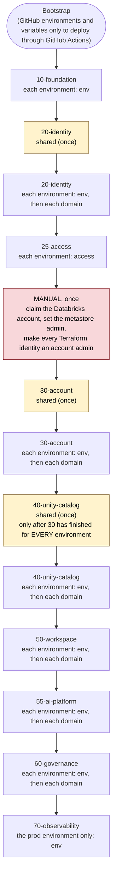

# Runbook: first-time setup

Eleven phases, in order. Each ends with a **Verify** step; do not continue until it
passes. Manual steps are marked **MANUAL**; everything else is Terraform.

Time: about a day spread over a week. Cost while idle: a few dollars a month for
storage and Key Vault; NAT gateway (if enabled) about USD 32/month; compute is pay
per use and serverless scales to zero.

> **What has and has not been proven.** The code in this repo is checked by unit
> tests, by mocked Terraform plans of every stack and target, and by
> `terraform validate`. **None of it has been applied to real Azure or Databricks yet.**
> Where a step depends on how a cloud service behaves (for example how fast
> Databricks syncs a new group), this runbook says so. Treat your first full build
> as the real test and report anything that differs.

---

## How this design works (read once, 5 minutes)

Every deployment is **one stack, for one environment, for one scope**. That is what lets you
deploy one domain to one environment without touching any other domain or environment.

| Term | Plain meaning |
|---|---|
| **Stack** | A numbered folder under `stacks/` (`10-foundation`, `20-identity`, ...). One kind of thing. |
| **Environment** | `dev`, `prd`, ... listed in `config/platform.yaml`. |
| **Tier** | Every environment is `nonprod` or `prod` (`tier:` in `platform.yaml`). Exactly one is `prod`. Rules depend on the tier, never on the name. |
| **Scope** | The slice of the platform one Terraform run owns (table below). |
| **State** | Terraform's record of what it built. There is **one state per stack + environment + scope**, so a run can only see and change its own slice. |
| **Entitlement** | A decision about *people*: who is in which group, which consumer may read which product. Kept in `config/entitlements/<env>/` and applied only by stack `25-access`. |
| **Release** | A git tag `rel-YYYY.MM.DD.N` on a commit. Cut with `scripts/release.py`. |
| **Promotion gate** | An environment with `promotes_from` (prd: `[dev]`) only accepts a **release** that was already deployed successfully, for the same stack and scope, to every environment listed. dev has `promotes_from: []`, so any commit may go to dev. |
| **Scope check** | Before applying, the wrapper reads the plan and refuses it if it changes anything the target does not own. It is a second lock behind the state split. |

The four scopes:

| Scope | Owns | State file |
|---|---|---|
| `shared` | account-wide things: governed tags, cross-environment platform groups, the AI Gateway budget. No environment. | `<stack>/shared.tfstate` |
| `env` | one environment's infrastructure: network, workspace, storage, vault/platform/sandbox catalogs, environment-wide warehouses | `<stack>/<env>/env.tfstate` |
| `access` | people and approvals in one environment (stack 25 only) | `<stack>/<env>/access.tfstate` |
| `domain:<name>` | one domain in one environment: its groups, catalog, schemas, warehouse, masks | `<stack>/<env>/domain-<name>.tfstate` |

Which stack supports which scope (from `stacks/<stack>/stack.yaml`):

| Stack | Scopes |
|---|---|
| 10-foundation | env |
| 20-identity | shared, env, domain |
| 25-access | access |
| 30-account | shared, env, domain |
| 40-unity-catalog | shared, env, domain |
| 50-workspace | env, domain |
| 55-ai-platform | env, domain |
| 60-governance | env, domain |
| 70-observability | env (the prod environment only) |

The tools (all take `--scope`, and `--env` for every scope except `shared`):

| Command | What it does |
|---|---|
| `python3 scripts/plan.py <stack> --scope S --env E` | plan one target, save the plan, run the scope check |
| `python3 scripts/apply.py <stack> --scope S --env E` | plan, confirm, apply, run the checks, write the deploy record |
| `python3 scripts/check.py <stack> --scope S --env E` | run the stack's post-apply checks again |
| `python3 scripts/plan_all.py --env E` | plan every target of an environment (read-only): drift report |
| `python3 scripts/release.py` | cut the next release tag on the current commit |
| `python3 scripts/status.py [--env E]` | which release is deployed where |
| `./scripts/tf.sh <stack> --scope S [--env E] <terraform args>` | low-level Terraform wrapper (sets the right state) |

`apply.py` exit codes: `0` done, `1` failed or invalid target, `2` declined at the
prompt (or `--yes` without `--plan`), `4` scope check refused the plan, `5` promotion
gate refused the release.

Two ways to deploy a target. They do the same thing:

```bash
# locally, interactive (you read the plan and type y)
python3 scripts/apply.py 40-unity-catalog --scope domain:claims --env dev --release rel-2026.10.23.1

# in GitHub: a plan job, then an approval, then an apply job that applies THAT plan
gh workflow run deploy.yml -f stack=40-unity-catalog -f environment=dev \
  -f scope=domain:claims -f ref=rel-2026.10.23.1
```

> **Replay:** Shown for `dev` only. Repeat the same commands for every other environment in `config/platform.yaml`, lowest tier first. `claims` stands for any domain: repeat for every domain in `config/domains.yaml`.

The **order** in which stacks must run is in [Phase 3 onwards](#phase-3-foundation-stack-10).
The short version: go **stack by stack**; within a stack run **dev first, then prd**;
within an environment run `env` before `domain:*`.

---

## Phase 1: Accounts and tooling (MANUAL, one-time, about 1 hour)

Skip every step you have already done. This table says how to tell:

| Step | Already done if | Check |
|---|---|---|
| 1 Azure subscription | you can sign in | `az account show --query id -o tsv` |
| 3 Resource providers | every provider says `Registered` | the check under step 3 |
| 4 Tools | each prints a version | `az --version \| head -1; terraform version; databricks --version; gh --version; python3 --version` |
| 5a, 5b Repository | your code is in your GitHub repo | `git remote -v`, then `git ls-remote origin` |
| 5c GitHub Environments | **Only needed to deploy through GitHub Actions** (`deploy.yml`). Skip it to deploy from your own machine with `scripts/apply.py`, and add it later | none |
| 6 `config/platform.yaml` | real tenant, subscription and storage names are filled in | `python3 scripts/validate_config.py` prints `Config OK` |

If everything above is done, go to Phase 2.

1. Create an Azure pay-as-you-go subscription. Its Entra tenant comes with it and
   you are its Global Administrator.
2. In Azure Cost Management, create a **subscription budget** (for example
   USD 100/month) with email alerts at 50/80/100%.
3. Register resource providers:
   ```bash
   az login
   for p in Microsoft.Databricks Microsoft.Storage Microsoft.Network Microsoft.KeyVault Microsoft.ManagedIdentity; do
     az provider register --namespace $p
   done
   ```
   > **What this does:** Azure requires you to explicitly "opt in" to each service
   > before you can create resources with it. `az provider register` tells your
   > subscription "I want to use this service." It is a one-time step per subscription.
   > The command is safe to run more than once — re-registering an already-registered
   > provider is a no-op.
   >
   > **How to check it worked:**
   > ```bash
   > for p in Microsoft.Databricks Microsoft.Storage Microsoft.Network Microsoft.KeyVault Microsoft.ManagedIdentity; do
   >   echo "$p: $(az provider show --namespace $p --query registrationState -o tsv)"
   > done
   > ```
   > Every line should print `Registered`. It can take a minute or two; run again if
   > any still show `Registering`.

4. Install: Azure CLI, Terraform >= 1.6, Databricks CLI, GitHub CLI (`gh`), Python 3.11+, git.
   ```bash
   pip install -r requirements.txt
   ```
   > This installs `pyyaml`, `ruamel.yaml`, `databricks-sdk`, and the repo's own
   > `util` package in editable mode (`-e .`). The `util` package is used by
   > `scripts/plan.py`, `scripts/apply.py`, and `scripts/check.py`. Run this
   > command again after pulling changes that add new files to `util/`.

5. Create the GitHub repository and push this code:

   **a. Create the repo on GitHub:**
   - Go to [github.com/new](https://github.com/new) (or your GitHub organisation's
     equivalent).
   - Name it `piq-databricks-platform` (or whatever you prefer — you will put this
     name in `config/platform.yaml` later).
   - Set it to **Private**.
   - Do **not** initialise it with a README (the repo already has one).

   **b. Push this code to it:**
   ```bash
   git remote set-url origin https://github.com/<your-org>/piq-databricks-platform.git
   git push -u origin main
   ```
   Replace `<your-org>` with your GitHub username or organisation name.

   **c. Create the GitHub Environments (only to deploy through GitHub Actions; skip this to deploy from your own machine).** On GitHub, open the repo → **Settings** →
   **Environments** → **New environment**. Names are case-sensitive: the workflows
   and the Azure trust rules use them. Create six (with the default `dev` and `prd`):

   | Environment | Used by | Required reviewers | Deployment branches |
   |---|---|---|---|
   | `shared` | apply jobs of scope `shared` | yes (it changes the whole account) | `main` only |
   | `shared-plan` | plan jobs of scope `shared` | no | no restriction |
   | `dev` | apply jobs for dev | optional | `main` only |
   | `dev-plan` | plan jobs for dev (and pull-request plans) | no | no restriction |
   | `prd` | apply jobs for prd | **yes** | `main` only |
   | `prd-plan` | plan jobs for prd (and the nightly drift check) | no | no restriction |

   Add one `<env>` and `<env>-plan` pair for every environment in
   `config/platform.yaml`. You set their variables in Phase 2.

   > **What this does.** `deploy.yml` plans in `<env>-plan`, then waits in `<env>` for a
   > reviewer, then applies the saved plan. GitHub only pauses where an environment has
   > required reviewers, so `prd` is where a person signs off. The `-plan` environments
   > have no branch restriction because pull-request plans run from a PR branch.
   > Start a deploy from the branch that contains `.github/workflows/deploy.yml`
   > (**Use workflow from: that branch**; `main` once your work is merged). The code that is
   > deployed is the `ref` you type (a release tag or a commit), not the branch the
   > workflow file comes from. Before the work is merged, change **Deployment branches** on
   > the environments above from `main` only to include your branch, or the jobs will be refused.

6. Fill in `config/platform.yaml` with your real values. Open the file and replace
   the placeholder values for these fields:

   | Field | Where to get it |
   |---|---|
   | `azure.tenant_id` | Azure portal → search "Tenant properties" → **Tenant ID**. Or run `az account show --query tenantId -o tsv` |
   | `azure.subscription_id` | Azure portal → your subscription overview → **Subscription ID**. Or run `az account show --query id -o tsv`. Yours is `b821d55b-210b-495c-a345-d2ab5775ad4b` |
   | `azure.location` | The Azure region where your workspaces will live. Use `eastus2` unless you have a reason to change it (it has the broadest Databricks serverless support). |
   | `unique_suffix` | Pick any 3–6 lowercase alphanumeric string (e.g. `a1b2`). This is appended to globally-unique resource names like the storage account to avoid name collisions across all Azure customers. |
   | `state.storage_account` | Must be 3–24 lowercase alphanumerics, globally unique across all Azure. Convention: `st` + your prefix + `tfstate` + your suffix, e.g. `stpiqtfstatea1b2`. You are choosing a name here — the bootstrap step will create this storage account. |
   | `github.org` | Your GitHub username or organisation name, exactly as it appears in your GitHub URLs (e.g. `avenugopal` or `premiumiq`). |
   | `notifications.ops_email` | An email address for budget and alert notifications. Use your own for now. |
   | `databricks.account_id` | Leave as `00000000-0000-0000-0000-000000000000` on a brand-new account; you fill this in during Phase 4. If you already have a Databricks account, it is already filled in. |

   > **Tip:** the prefix `piq` and the suffix `a1b2` are already in the file as examples.
   > You can keep them or change them — just keep `prefix` to 2–5 lowercase letters.

   Each environment under `environments:` also has a **tier**, `promotes_from` and
   `allow_hotfix`. Keep the shipped values (`dev`: nonprod, `promotes_from: []`;
   `prd`: prod, `promotes_from: [dev]`, `allow_hotfix: true`). Adding `qa`, `uat` or
   `dev2` later is an entry here, not a code change; see [OPERATIONS.md](OPERATIONS.md).

**Verify:** `python3 scripts/validate_config.py` prints `Config OK`.

## Phase 2: Bootstrap (local Terraform)

**Run it** if bootstrap has never been applied, or if `terraform plan` in `bootstrap/` shows changes. It
is safe to run again: Terraform only changes what differs. Bootstrap runs once per setup, and again
whenever `bootstrap/` itself changes or you add an environment to `config/platform.yaml` (each
environment gets its own resource group and identity).

> **What this phase does:** creates, in Azure and Entra:
> 1. A **storage account + container** to hold all future Terraform state files remotely
>    (so CI and your local machine share the same state).
> 2. One **resource group per environment** (`rg-piq-dev`, `rg-piq-prd`). They are made
>    here, not by stack 10, so each environment's identity can be limited to its own.
> 3. A **shared service principal** (`sp-piq-terraform`) for scope `shared`, and one
>    service principal **per environment** (`sp-piq-terraform-dev`, `sp-piq-terraform-prd`).
>    A service principal is a robot account. None has a password: each authenticates
>    through GitHub OIDC (a trust relationship).
> 4. **Role assignments**: each environment's identity gets Azure *Contributor* and
>    *Role Based Access Control Administrator* on **its own resource group only**; all of
>    them can use the state storage.
>
> Bootstrap itself runs locally (as you, not a service principal) because they do not
> exist yet. Its own state file stays on your machine (`bootstrap/terraform.tfstate`).

```bash
cd bootstrap
terraform init
terraform plan -out tfplan       # read it: state storage, rg-piq-<env>, the identities, roles, trust
terraform apply tfplan
terraform output github_variables
terraform output env_terraform_sps
terraform output next_steps
```

If bootstrap was applied before, the plan also replaces its single-identity federated
credentials (`pull_request`, `environment:platform`) with the per-environment ones and adds
the per-environment pieces. That is expected.

> **What `terraform init` does:** downloads the provider plugins (azurerm, azuread)
> into a local `.terraform/` directory. Safe to run repeatedly.
>
> **What `terraform plan` does:** compares the desired state (the `.tf` files) against
> what currently exists in Azure, and prints a list of changes it *would* make.
> It does not change anything. Always review the plan before applying.
>
> **What `terraform apply` does:** executes the plan — creates/updates/deletes
> resources in Azure to match the `.tf` files.

**You do not need to give any identity a password or manually grant it access to GitHub.**
The bootstrap Terraform sets up **OIDC (OpenID Connect)** — a password-free trust
relationship between GitHub Actions and Azure:

- Each identity is told: "trust a GitHub Actions job from the
  `<github.org>/piq-databricks-platform` repository that runs in **this GitHub
  environment**". `sp-piq-terraform` trusts `shared` and `shared-plan`;
  `sp-piq-terraform-dev` trusts `dev` and `dev-plan`; `sp-piq-terraform-prd` trusts
  `prd` and `prd-plan`. These are the **federated credentials** on each identity.
- When a CI job runs, GitHub gives it a short-lived token. The job presents that token to
  Azure, Azure checks the trust rules, and grants that identity's permissions for that job
  only. No password is ever stored anywhere. A job in the `dev` environment cannot sign
  in as the prd identity.

`github_variables` prints the three IDs each GitHub Environment needs (**only needed to deploy through GitHub Actions**). Set them as
**environment variables** (repo → Settings → Environments → pick the environment →
**Environment variables**; use Variables, not Secrets: these are IDs, not passwords):
`AZURE_CLIENT_ID`, `AZURE_TENANT_ID`, `AZURE_SUBSCRIPTION_ID`.

| Output | Set on GitHub environments |
|---|---|
| `github_variables.shared` | `shared`, `shared-plan` |
| `github_variables.by_environment.dev` | `dev`, `dev-plan` |
| `github_variables.by_environment.prd` | `prd`, `prd-plan` |

> **What this does and does not protect.** Azure rights are limited per environment: the
> dev identity cannot create or change anything in `rg-piq-prd`. **Microsoft Entra
> (groups, users, app registrations) and the Databricks account only offer
> tenant-wide or account-wide rights.** So the dev identity is not *technically* blocked
> from editing prd groups or account objects; what stops it is that the pipeline only
> ever runs a target in its own environment, and the scope check. The state storage
> account is also shared by all identities. Entra administrative units and per-environment
> state containers are later hardening steps.

**Back up `bootstrap/terraform.tfstate`.** This file lives on your laptop and is
git-ignored (never committed). It is the only record Terraform has of the bootstrap
resources it created. If you lose it, Terraform will think those resources don't
exist and try to create duplicates. Copy it somewhere safe — a personal OneDrive
folder is fine for now.

**Verify:** in Entra ID → App registrations, `sp-piq-terraform`, `sp-piq-terraform-dev`
and `sp-piq-terraform-prd` exist; each has two federated credentials; Microsoft Graph
API permissions show "Granted". `az group list --query "[?starts_with(name,'rg-piq')].name"`
shows `rg-piq-tfstate`, `rg-piq-dev`, `rg-piq-prd`. All six GitHub environments exist and
carry their three variables.

## The deploy order and releases (read before Phase 3)

From here you deploy targets in a fixed order. The whole order, so you can see where
each phase fits (**go stack by stack; lowest tier first; inside a stack `shared`, then `env`, then `domain:*`**):

| # | Stack | Targets (repeat for each environment, lowest tier first) | Why this position |
|---|---|---|---|
| 1 | 10-foundation | `env` | workspaces and storage must exist first |
| 2 | 20-identity | `shared` (once) | creates the groups that span environments (for example `piq-metastore-admins`); every environment's persona links into them are made by that environment's own run |
| 3 | 20-identity | `env`, then each `domain:*` | domain groups are nested under by the persona groups the `env` run creates |
| 4 | 25-access | `access` | the groups it fills must exist |
| — | **Phase 4 (MANUAL, once)** | claim account, metastore admin, account admins | |
| 5 | 30-account | `shared` (once), then `env`, then each `domain:*` | puts every group and service principal into the Databricks account |
| 6 | 40-unity-catalog | `shared` (once), then `env`, then each `domain:*` | `shared` creates the governed tags the others use; `env` creates the storage credential the domains use |
| 7 | 50-workspace | `env`, each `domain:*` | warehouses and compute policies |
| 8 | 55-ai-platform | `env`, each `domain:*` | optional (see Phase 7) |
| 9 | 60-governance | `env`, then each `domain:*` | `env` creates the masking functions the domain policies call |
| 10 | 70-observability | `env` (the prod environment only) | views over system tables |

### The build order as a diagram



Read it top to bottom. Yellow boxes are **shared** scopes: they run once, not once per environment. "Each environment"
means the whole box is repeated for every environment in `config/platform.yaml`, lowest tier first, and "each domain" for every
domain in `config/domains.yaml`. Nothing in the diagram names an environment or a domain, so it stays true when config changes.

**Not every stack has every scope.** Each stack lists the scopes it supports in `stacks/<stack>/stack.yaml`, and the
boxes follow that file:

| Scopes a stack has | Stacks |
|---|---|
| `shared`, `env` and `domain` | 20-identity, 30-account, 40-unity-catalog |
| `env` and `domain` | 50-workspace, 55-ai-platform, 60-governance |
| `access` only | 25-access |
| `env` only | 10-foundation, 70-observability (70 only in the prod environment) |

Inside a stack the build order is always `shared`, then `env`, then `domain`, for whichever of those the stack has.
Teardown reverses it: see [TEARDOWN.md](TEARDOWN.md).

Two ordering rules come from reading the code, not from a real build, so treat them as
the likely behaviour and tell us if the cloud disagrees:

- `40-unity-catalog shared` creates the governed tags and names, as tag assigners, the
  groups of **every** environment. Run stack 30 for **all** environments before it.
  Re-run it when you add an environment.
- `20-identity shared` runs **first** and only once. Re-run it when you add an environment
  only to add that environment's Terraform identity to `piq-metastore-admins`.

### Cutting a release

A prd target only accepts a **release**: a git tag that already passed in dev for the same stack and scope.
`scripts/release.py` creates the tag and names it for you: `rel-`, today's date, and a counter for that day
(`rel-2026.10.26.1`, then `.2`). You do not choose the name.

A release tags the commit you are on, so:

1. **Commit everything.** `release.py` refuses to run on a working tree with uncommitted changes, because the tag
   must name exactly the code you will deploy.
2. **Be on the branch that holds the code you want to release.** That is `main` once your work is merged; before
   that, your feature branch. Nothing requires `main`.
3. Cut the tag, then check it out, so the code that runs is the code that was released:

```bash
git status                           # must show a clean working tree
python3 scripts/release.py           # prints the tag it created, e.g. "Created rel-2026.10.26.1"
REL=rel-2026.10.26.1                 # use the name it printed
git checkout $REL                    # run everything below from this tag
```

When you are finished deploying, `git switch <your branch>` takes you back.

Add `--push` to `release.py` only if you will deploy through GitHub Actions, because `deploy.yml` checks the
tag out from GitHub. Deploying from your own machine does not need the tag pushed. A prd target needs the same
`$REL` that passed in dev, so cut the release once and deploy every target from it, dev first.

> If you edit `config/` during the build (on a brand-new account you must add the
> Databricks account ID in Phase 4), commit it, cut a **new** release, and run the
> dev targets again from it (they plan empty and just record the new release as
> deployed). Check with `python3 scripts/status.py --env dev`.

## Phase 3: Foundation (stack 10)

The Azure foundation: workspaces and storage for each environment. Everything after it depends on it.
Run this from the release you checked out above (`$REL`).

### Stack 10, environment by environment

```bash
python3 scripts/apply.py 10-foundation --scope env --env dev --release $REL
python3 scripts/apply.py 10-foundation --scope env --env prd --release $REL
```

> **Replay:** This block names `dev` and `prd`, the two environments in `config/platform.yaml` today. Use your own environment names, and repeat the commands once for each environment, lowest tier first.

Or in GitHub: `gh workflow run deploy.yml -f stack=10-foundation -f environment=dev -f scope=env -f ref=$REL`
(then approve in the Actions run for any environment with required reviewers).

`apply.py` runs plan, shows it, asks for confirmation, applies, runs the stack's checks
(workspace reachable, storage account provisioned) and writes a record of the deploy
(to the `deployments` container of the state storage account) plus an audit line in
`audit/runs.jsonl`. Stack 10 looks up the resource group that bootstrap made; it does not
create it.

Workspace creation takes 5–10 minutes each. The first Premium workspace creates a
Databricks account if you do not have one yet.

**Verify:**
```bash
python3 scripts/check.py 10-foundation --scope env --env dev
python3 scripts/check.py 10-foundation --scope env --env prd
```

> **Replay:** This block names `dev` and `prd`, the two environments in `config/platform.yaml` today. Use your own environment names, and repeat the commands once for each environment, lowest tier first.

Each workspace URL must be reachable and each storage account provisioned. Also confirm
both workspace URLs open in a browser and you can sign in.

## Phase 4: Identity, then claim the Databricks account

### 4a. Check that you are a platform-admin in both environments (before running stack 25)

Who holds a persona is an **entitlement**, kept per environment in
`config/entitlements/<env>/personas.yaml` and applied by stack `25-access`. Today
`platform-admin` is assigned to `avenugopal`, `mrinne`, `bbailey`, `gcoppola` and
`sparal` (all `@premiumiq.com`) in **both** `dev` and `prd`. Check that your UPN is in
both files:

```bash
az ad signed-in-user show --query userPrincipalName -o tsv
grep -n "$(az ad signed-in-user show --query userPrincipalName -o tsv)" config/entitlements/dev/personas.yaml config/entitlements/prd/personas.yaml
```

> **Replay:** This block names `dev` and `prd`, the two environments in `config/platform.yaml` today. Use your own environment names, and repeat the commands once for each environment, lowest tier first.

If it is not, add a line to each file (and open a pull request in a team setting):

```yaml
users:
  your-upn@yourdomain.com: [platform-admin]
```

> **What a UPN is:** User Principal Name — Microsoft's term for the login name of a
> user in Entra ID. It looks like an email address and is unique across your tenant.
> Stack 25 uses it to look up your Entra user and add it to the persona group.

**Why this matters.** The `platform-admin` persona of each environment is nested into
`piq-metastore-admins`. That group is what gives you MANAGE on the Unity Catalog
`system` catalog. Without it, stack 50 for the prod environment fails with
`User does not have MANAGE on Catalog 'system'`. That grant is made by the
`50-workspace` `env` run of the prod environment.

> **Entitlements are a stand-in.** `config/entitlements/` and stack 25 exist so you can
> run without an identity-governance tool. When SailPoint, Saviynt or similar takes over,
> you delete that folder and stack; the group names (`piq-<env>-persona-<name>`) stay.

### 4b. Apply stack 20, then stack 25

In this order (see the table in Phase 3). Use `--release $REL` as above:

```bash
for env in dev prd; do
  python3 scripts/apply.py 20-identity --scope env --env $env --release $REL
done
for env in dev prd; do
  for d in claims policy_financial profitability; do
    python3 scripts/apply.py 20-identity --scope domain:$d --env $env --release $REL
  done
done
python3 scripts/apply.py 20-identity --scope shared --release $REL      # once; no --env
for env in dev prd; do
  python3 scripts/apply.py 25-access --scope access --env $env --release $REL
done
```

> **Replay:** The loop names the environments: replace `dev prd` with the environments in `config/platform.yaml`, lowest tier first.

(Run `dev` first for each stack: prd refuses a release that has not passed in dev. The loops
above do exactly that.) The domain list is the keys of `config/domains.yaml`. In GitHub the same
is `gh workflow run deploy.yml -f stack=20-identity -f environment=dev -f scope=env -f ref=$REL`,
and for the shared scope leave `environment` empty.

Training only: get the test-user passwords (their group memberships are applied by stack 25):
```bash
./scripts/tf.sh 20-identity --scope shared init
./scripts/tf.sh 20-identity --scope shared output -json test_user_credentials
```

**Verify:**
```bash
python3 scripts/check.py 20-identity --scope shared
python3 scripts/check.py 20-identity --scope env --env prd
python3 scripts/check.py 25-access --scope access --env prd
```

> **Replay:** Shown for `prd` only. Repeat the same commands for every other environment in `config/platform.yaml`, lowest tier first.
Stack 20 checks: every expected Entra group of that scope exists, and the service
principals that trust GitHub have their OIDC credentials. Stack 25 checks that every
membership and approval in `config/entitlements/<env>/` was applied. Who is *in* a group
is a stack 25 matter; stack 20 does not check it.

### 4c. Claim the Databricks account (MANUAL, once)

If you already have a Databricks account, steps 1 to 3 are already done for
`sp-piq-terraform`; still do step 3 for the two new per-environment identities.

1. Open `https://accounts.azuredatabricks.net` and sign in as the Global
   Administrator. The first sign-in makes you an **account admin**.
2. Copy the **Account ID** into `config/platform.yaml` (`databricks.account_id`),
   commit and push (and cut a new release, see the note in Phase 3). The Account ID is
   shown in the top-right user menu — click your name/email in the top-right corner and
   it appears in the dropdown.
3. **User management** (left sidebar) → **Service principals** tab → **Add service
   principal** → search for each of `sp-piq-terraform`, `sp-piq-terraform-dev` and
   `sp-piq-terraform-prd` (one per environment; `terraform output env_terraform_sps` in
   `bootstrap/` lists them) → select it → **Add**. Then open each from the list →
   **Roles** tab → enable **Account admin**.
4. **Catalog** (left sidebar) → select the metastore (there should be one for your
   region) → **Metastore admin** → change it to the group `piq-metastore-admins`
   (stack 20 `shared` creates it, which is why that ran first). Also check the
   **Workspaces** tab of the metastore: both new workspaces must be assigned to it. If
   one is not, assign it. (Not tested against a real account; Databricks may assign
   automatically.)

**Verify:** **Workspaces** (left sidebar) lists both `dbw-piq-dev` and `dbw-piq-prd`;
**Catalog** (left sidebar) shows the metastore with admin set to `piq-metastore-admins`
and both workspaces assigned. The three identities have the **Account admin** role.

## Phase 5: Account (stack 30)

```bash
python3 scripts/apply.py 30-account --scope shared --release $REL        # once; no --env
for env in dev prd; do
  python3 scripts/apply.py 30-account --scope env --env $env --release $REL
  for d in claims policy_financial profitability; do
    python3 scripts/apply.py 30-account --scope domain:$d --env $env --release $REL
  done
done
```

> **Replay:** The loop names the environments: replace `dev prd` with the environments in `config/platform.yaml`, lowest tier first.

Stack 30 finds groups, service principals and users **by name in Entra** (stack 20 and
25 ran first), then resolves them into the Databricks account.

After stack 20 applies, wait approximately one minute before running stack 30. Automatic
Identity Management (AIM) syncs Entra groups into Databricks on a short delay. The
checks have RETRY logic for the assertions that depend on it: they wait and recheck
automatically. (How long AIM takes in practice has not been measured.)

**Verify:**
```bash
python3 scripts/check.py 30-account --scope env --env prd
python3 scripts/check.py 30-account --scope domain:claims --env prd
```

> **Replay:** Shown for `prd` only. Repeat the same commands for every other environment in `config/platform.yaml`, lowest tier first. `claims` stands for any domain: repeat for every domain in `config/domains.yaml`.
Checks: the usage policies of that scope exist, and the groups it assigns to the
environment's workspace are really assigned.

---

## Running a target as an environment's Terraform identity (after Phase 4c)

CI always signs in as the identity of the target's environment: `sp-piq-terraform-dev`
for anything in `dev`, `sp-piq-terraform-prd` for `prd`, `sp-piq-terraform` for scope
`shared`. Each is an account admin in Databricks and (through stack 20 `shared`) a
member of `piq-metastore-admins`. You can run locally as one of them to reproduce
exactly what CI does, or apply a target without using your own credentials.

**When this is possible:** only after Phase 4c step 3 (the identity is an account admin) and
after stack 20 `shared` has run (it adds each identity to `piq-metastore-admins`). Before
that, the identity lacks the Unity Catalog rights later stacks need. On a first deploy,
your own `az login` (Owner on the subscription, account admin) is simpler.

The identities were created with OIDC only, with no client secret. To log in locally you
create a temporary secret in Entra. The example uses the dev identity; replace the name
for another.

1. Find the app registration:
   ```bash
   az ad app list --display-name "sp-piq-terraform-dev" --query "[0].appId" -o tsv
   ```

2. Create a temporary secret (it is shown once — save it):
   ```bash
   az ad app credential reset --id <appId-from-step-1> --append \
     --display-name "local-dev-temp" --years 1
   ```
   This prints `appId`, `password` (the secret), and `tenant`.

3. Log in as the identity:
   ```bash
   az login --service-principal \
     --username <appId> \
     --password <password> \
     --tenant <tenantId>
   ```

4. Run a target as normal:
   ```bash
   python3 scripts/apply.py 50-workspace --scope env --env dev --release $REL
   ```
   Or with the low-level wrapper (it needs `--scope`, and `--env` unless the scope is `shared`):
   ```bash
   ./scripts/tf.sh 50-workspace --scope env --env dev init
   ./scripts/tf.sh 50-workspace --scope env --env dev plan -out dev-env.tfplan
   ./scripts/tf.sh 50-workspace --scope env --env dev apply dev-env.tfplan
   ```
   The wrappers write a deploy record to the state storage account with whoever is signed in.
   Tell `apply.py` not to with `--no-record` only for throwaway experiments, because the
   promotion gate relies on those records.

5. **Clean up the secret when done** — the identity is normally passwordless and the
   secret is a security downgrade. Delete it from the Azure portal:
   Entra → App registrations → `sp-piq-terraform-dev` → **Certificates & secrets** →
   find `local-dev-temp` → delete it.
   Or via CLI:
   ```bash
   # List credential key IDs to find the one to delete
   az ad app credential list --id <appId> --query "[].{name:displayName, keyId:keyId}"
   # Delete by key ID
   az ad app credential delete --id <appId> --key-id <keyId>
   ```

> **Note:** creating a client secret does not affect the existing OIDC federated
> credentials that CI uses. They are separate. Deleting the temp secret after use
> returns the identity to its passwordless state without touching CI.

---

## Phase 6: Unity Catalog (stack 40)

Order: `shared` once (creates the governed tags), then per environment `env` (creates the
environment's storage credential and its vault, platform, sandbox and, in prd, consumer
catalogs), then each `domain:*`. dev first, then prd.

```bash
python3 scripts/apply.py 40-unity-catalog --scope shared --release $REL      # once
for env in dev prd; do
  python3 scripts/apply.py 40-unity-catalog --scope env --env $env --release $REL
  for d in claims policy_financial profitability; do
    python3 scripts/apply.py 40-unity-catalog --scope domain:$d --env $env --release $REL
  done
done
```

> **Replay:** The loop names the environments: replace `dev prd` with the environments in `config/platform.yaml`, lowest tier first.

`shared` calls Databricks through the first nonprod environment's workspace (here `dev`)
because the tag API is workspace-scoped, so the dev workspace must exist and stay.

Across all targets the plans cover 14 catalogs (vault, three domains and platform/sandbox per
environment, plus `prd_exec_reporting` and `prd_claims_anon`), about 74 schemas, governed
tags, grants and bindings. That is what the mocked plans show; each real plan is much smaller
because each target owns only its slice. Review each plan before confirming.

**Verify:**
```bash
python3 scripts/check.py 40-unity-catalog --scope domain:claims --env prd
```

> **Replay:** Shown for `prd` only. Repeat the same commands for every other environment in `config/platform.yaml`, lowest tier first. `claims` stands for any domain: repeat for every domain in `config/domains.yaml`.
Checks that the catalogs of that scope exist and that the producer group has USE_CATALOG
on the domain catalog. (`prd_claims_anon` is created by the claims domain scope in prd.)

Also verify in the dev workspace SQL editor:
```sql
SHOW CATALOGS;                                  -- dev_* catalogs and prd_claims_anon only
SHOW SCHEMAS IN dev_claims;                     -- private schemas plus product_loss
SHOW GRANTS ON SCHEMA dev_claims.product_loss;  -- piq-dev-product-loss has SELECT
SHOW GRANTS ON CATALOG dev_claims;              -- product groups: USE CATALOG only
```

## Phase 7: Workspace configuration (stacks 50 and 55)

```bash
for env in dev prd; do
  python3 scripts/apply.py 50-workspace --scope env --env $env --release $REL
  for d in claims policy_financial profitability; do
    python3 scripts/apply.py 50-workspace --scope domain:$d --env $env --release $REL
  done
done
for env in dev prd; do
  python3 scripts/apply.py 55-ai-platform --scope env --env $env --release $REL
  for d in claims policy_financial profitability; do
    python3 scripts/apply.py 55-ai-platform --scope domain:$d --env $env --release $REL
  done
done
```

> **Replay:** The loop names the environments: replace `dev prd` with the environments in `config/platform.yaml`, lowest tier first.

The `env` run of `50-workspace` holds the workspace settings, compute policies and the
environment's own warehouses (`piq-vault-load`, `piq-shared`, and `piq-exec-reporting-bi`
in prd). Each `domain:*` run holds that domain's `piq-<domain>-transform` warehouse. The
`env` run of the **prod** environment also grants the monitoring group access to the
`system` catalog; see Phase 4a.

> **Note on stack 55:** some AI platform features (App Spaces, Lakebase) are in
> private preview and may fail depending on your account's access. Stack 55 is
> safe to skip for the initial build — stacks 60 and 70 do not depend on it.

**Verify:**
```bash
python3 scripts/check.py 50-workspace --scope env --env prd
python3 scripts/check.py 50-workspace --scope domain:claims --env dev
```

> **Replay:** This block names `dev` and `prd`, the two environments in `config/platform.yaml` today. Use your own environment names, and repeat the commands once for each environment, lowest tier first. `claims` stands for any domain: repeat for every domain in `config/domains.yaml`.
Checks that the warehouses of that scope exist, and (prod `env` run) that the monitoring
group has USE_CATALOG on the system catalog.

Also confirm in the workspace UI: SQL Warehouses shows `piq-claims-transform`,
`piq-policy-financial-transform`, `piq-profitability-transform`, `piq-vault-load`
and `piq-shared` in both workspaces, and `piq-exec-reporting-bi` in prd only.
As `test.analyst`, only the three domain warehouses are usable. Personal access
tokens are unavailable.

## Phase 8: Governance and observability (stacks 60 and 70)

Stacks 60 and 70 run SQL through `scripts/run_sql.py` on `piq-shared`. The
`databricks-sdk` required for this is installed by `pip install -r requirements.txt`.

```bash
for env in dev prd; do
  python3 scripts/apply.py 60-governance --scope env --env $env --release $REL   # masking functions first
  for d in claims policy_financial profitability; do
    python3 scripts/apply.py 60-governance --scope domain:$d --env $env --release $REL
  done
done
python3 scripts/apply.py 70-observability --scope env --env prd --release $REL    # prod environment only
```

> **Replay:** The loop names the environments: replace `dev prd` with the environments in `config/platform.yaml`, lowest tier first.

Stack 70 refuses any environment but the prod one: system tables are account-wide, so
one set of views in `prd_platform` covers everything.

**Verify** (SQL editor in either workspace):
```sql
SHOW FUNCTIONS IN dev_platform.governance;        -- mask_ssn, mask_dob, mask_email, mask_phone, mask_name, mask_amount
SHOW POLICIES ON CATALOG dev_claims;              -- six mask_* policies
SELECT * FROM prd_platform.governance.products;   -- in prd: loss, earned_premium, loss_ratio
```
and `python3 scripts/check.py 60-governance --scope domain:claims --env prd`.

## Phase 9: Confirm what is deployed where

```bash
python3 scripts/status.py            # the latest successful deploy of every target
python3 scripts/plan_all.py --env dev
python3 scripts/plan_all.py --env prd
```

> **Replay:** This block names `dev` and `prd`, the two environments in `config/platform.yaml` today. Use your own environment names, and repeat the commands once for each environment, lowest tier first.

`status.py` should show `$REL` against every dev and prd target. `plan_all.py` plans every
target of an environment without applying anything; right after a clean build every row
should say `no changes`. Run it again later to find **drift**: a target with changes that
nobody merged was changed by hand (the nightly `drift.yml` workflow does the same).

**Verify:** every target shows `$REL`, and `plan_all.py` reports no changes in both environments.
This is also the first real proof that the scope check and promotion gate behave against
real state: the unit tests only prove them against fixtures.

## Phase 10: Prove the access design

Run `sql/labs/lab06_masking_test.sql` (dev) and `sql/labs/lab11_products.sql` (prd).

| Check | Expected |
|---|---|
| Producer reads a tagged table | masked values (only SARs and writers are exempt) |
| Producer after joining the `claimant_pii` SAR | clear values (add the group to `config/entitlements/<env>/sars.yaml`, deploy `25-access` for that environment) |
| Analyst reads `dev_vault.landing` | `PERMISSION_DENIED` |
| Any user references `prd_claims` from dev | catalog not accessible |
| `test.executive` lists `prd_profitability` | only `product_loss_ratio` |
| `test.executive` lists `prd_claims` | no schemas (not approved for Loss) |
| `prd_platform.audit.denied_requests` | shows the refused attempts |

## Phase 11: Day-2 readiness

1. Wire the access portal to `.github/workflows/provision-access.yml` (the Worker
   writes the `<!-- piq-access {...} -->` block into the issue body; every request now
   names its `env`). It edits `config/entitlements/<env>/` through a pull request.
2. Turn on branch protection: require PR reviews and Code Owner review on `main`.
   `.github/CODEOWNERS` already asks for stricter review of `config/entitlements/prd/`.
3. Practise teardown on a small environment ([TEARDOWN.md](TEARDOWN.md)), and each procedure in [OPERATIONS.md](OPERATIONS.md) once: deploy a domain to dev
   then prd, cut a release, promote it, roll a shared-rule change out to every domain.
4. After a week, review `prd_platform.monitoring.cost_untagged_usage` and the
   serverless egress denial logs, then set prd `enforcement_mode: ENFORCED`.
