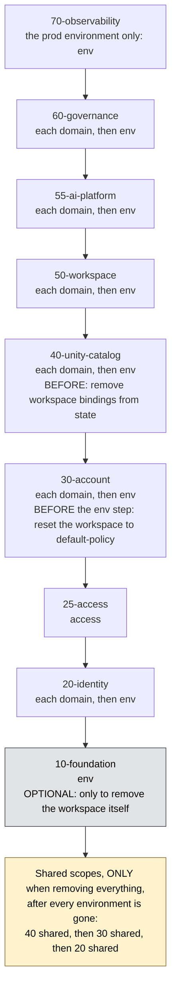

# Teardown: removing an environment, a domain, or everything

How to remove things safely, in the right order. This is a **process to follow by hand**. Nothing here is
automated yet: the plan is to run it manually on a small environment first, correct this page from what really
happens, and only then automate what proved stable.

How much each statement is trusted:

- **Seen** means it happened on a real account during a teardown.
- **Code** means it follows from reading the stacks (what reads what). Not tried on a real account.
- **Untested** means a guess about the cloud.

Related: [RUNBOOK.md](RUNBOOK.md) (building), [OPERATIONS.md](OPERATIONS.md) (day-2 tasks),
[TROUBLESHOOTING.md](TROUBLESHOOTING.md).

---

## 1. What you are removing

| You want to remove | Run these targets | Leaves alone |
|---|---|---|
| One domain, in one environment | `domain:<name>` of every stack that has one | The environment, other domains, shared |
| One whole environment | Every `domain:*`, `access`, and `env` target of that environment | Shared scopes, other environments, Azure foundation (unless you add stack 10) |
| Everything | Every environment as above, then the `shared` scopes | Whatever you keep on purpose (state storage, `bootstrap/`, the Databricks account) |

Stack 10 (the Azure foundation: workspaces, storage, Key Vault) is only destroyed if you mean to remove the
workspace itself. See section 5.

## 2. These 3 rules determine the order

1. **Reverse of deploy.** Highest stack number first. Inside a stack: `domain:*`, then `env`, then `shared`.
2. **A stack that looks something up must be destroyed before the thing it looks up.** (Code)
   - Stack 30 finds groups in Entra by name, so 30 goes **before** 20.
   - Stack 25 finds groups by name, so 25 goes **before** 20.
   - Stack 55 reads stack 30's usage policies, so 55 goes **before** 30.
   - Stack 60 (`env`) reads stack 50's warehouse, and 70 reads 50 too, so 60 and 70 go **before** 50.
   - Stacks 30, 40, 50, 55, 60 and 70 read stack 10's workspace address, so 10 goes last.
   - A `domain` scope of stack 40 uses the storage credential that the `env` scope made, so domains go before `env`.
   - A `domain` scope of stack 60 calls masking functions that the `env` scope made, so the same.
   - Every `env` scope of stack 20 links personas into groups that `shared` made, so `shared` goes last.
3. **Do not destroy the next target until the last one is empty.** Check after each one (section 4).

If you break rule 2, Terraform cannot even read its own configuration and fails with messages like
`outputs is object with no attributes`. (Seen: stack 30 after stack 20 had been destroyed.)

## 3. The order for one environment



This diagram is for **one environment**. Run it top to bottom for that environment, check each step is empty (section 4), then
run it again for the next environment. Nothing in it names an environment or a domain.

**Does every stack follow domain, then env, then shared?** No. Each stack only has the scopes listed in its
`stacks/<stack>/stack.yaml`:

| Scopes a stack has | Stacks | Teardown order inside the stack |
|---|---|---|
| `shared`, `env` and `domain` | 20, 30, 40 | each `domain`, then `env`. The `shared` scope is **not** part of an environment's teardown: it goes at the very end, with the other shared scopes |
| `env` and `domain` | 50, 55, 60 | each `domain`, then `env` |
| `access` only | 25 | `access` |
| `env` only | 10, 70 | `env` |

Why `shared` waits: a shared scope covers every environment (the governed tags, the cross-environment groups). It can only go once
no environment still uses it. Why `domain` goes before `env`: a domain's objects use things its `env` scope made (the storage
credential in 40, the masking functions in 60), so the `env` scope has to outlive them.

The same order as a table:

Run each line as: init the target, read the destroy plan, destroy, check it is empty (section 4).

| # | Stack | Scopes, in this order | Why here |
|---|---|---|---|
| 1 | `70-observability` | `env` (prod environment only) | Reads stack 50 |
| 2 | `60-governance` | each `domain:*`, then `env` | Policies before the functions they call |
| 3 | `55-ai-platform` | each `domain:*`, then `env` | Reads stack 30 |
| 4 | `50-workspace` | each `domain:*`, then `env` | Warehouses; read by 60 and 70 |
| 5 | `40-unity-catalog` | each `domain:*`, then `env` | Before-steps in section 6 apply here |
| 6 | `30-account` | each `domain:*`, then `env` | Before-step in section 6 applies to `env` |
| 7 | `25-access` | `access` | Memberships, before the groups go |
| 8 | `20-identity` | each `domain:*`, then `env` | Groups and service principals |
| 9 | `10-foundation` | `env` | Only if removing the workspace |

Each target is run with, for example:

```bash
./scripts/tf.sh 40-unity-catalog --env <env> --scope domain:<domain> init
./scripts/tf.sh 40-unity-catalog --env <env> --scope domain:<domain> destroy
```

**Removing everything**: do the table above for every environment, then the shared scopes in this order:
`40-unity-catalog` shared, `30-account` shared, `20-identity` shared. Stack 40 `shared` holds the governed tags; stack 20
`shared` holds the cross-environment groups.

**Removing one environment but keeping the others**: destroy that environment's targets (the table), then remove the
environment from `config/platform.yaml`, then apply `20-identity` shared and `40-unity-catalog` shared again. They name every
environment's identities and groups, so they need to forget the removed one.

## 4. After each target: is it empty?

```bash
./scripts/tf.sh <stack> --env <env> --scope <scope> state list | grep -v '^data\.'
```

No output means that target is empty. Anything listed is still in your account and Terraform will keep trying to delete it.
Do not move on while a target has resources left. Many stack 40 objects depend on each other, so a single stuck object
leaves dozens behind. (Seen: 46 left from five stuck schemas.)

At the end, check the account itself, not only Terraform's records:

- Entra: `az ad group list --display-name piq- --query "length(@)"` should be 0 (after stack 20).
- Databricks, Catalog: only `system`, `samples` and the workspace default catalog remain (after stack 40).
- Databricks account console: no `piq-*` budgets, usage policies or network policies (after stack 30).

## 5. Things to decide before you start

- **Is there data?** Domain, vault and consumer schemas are never force-deleted by the stacks. If a schema holds tables or
  volumes, stack 40 stops there. That is deliberate. Move or drop the data yourself first.
- **Keep the Azure foundation?** Destroying stack 10 deletes the workspace and storage. Key Vault names stay reserved
  afterwards (the prod vault is purge-protected for 90 days), so you cannot recreate the same name. Usually leave stack 10.
- **Is anything else using it?** Nothing in this repo is shared between environments except the `shared` scopes.

## 6. Known blockers

Each one made a destroy fail. Fix the cause, then re-run the same target. Finished targets are not affected.

| # | When | What you see | Cause and fix | Status |
|---|---|---|---|---|
| 1 | Stack 40, before the destroy | Later: `Catalog '...' is not accessible in current workspace` on grants, tags, volumes | An isolated catalog is only reachable through its workspace binding. If Terraform deletes the binding first, nothing inside is reachable. Before destroying, remove the bindings from Terraform's state so they go with the catalog: `terraform state rm 'module.uc[0].databricks_workspace_binding.catalog' 'module.uc[0].databricks_workspace_binding.readonly'` (for the target you are about to destroy). If you already hit the error: recreate the bindings with `apply -refresh=false -target=...` on the same two resources, then `state rm`, then destroy | **Seen**, fix worked. The module orders children before the binding, which helps but is not proven to be enough on its own |
| 2 | Stack 30, `env` scope, before the destroy | `Cannot delete network policy ... because it is attached to 1 running workspace(s)` | Destroying the workspace's network option does not detach the policy. Set the workspace back to `default-policy` first (the Databricks SDK documents this: `AccountClient.workspace_network_configuration.update_workspace_network_option_rpc`, `network_policy_id="default-policy"`) | **Seen**. The cause is clear; the reset itself was not run through this API here |
| 3 | Stack 40, near the end | `Schema 'x_platform.governance' is not empty` | Stacks 60 and 70 put functions and views in the platform schemas using SQL, which Terraform does not track. Delete the schema with its contents (`DROP SCHEMA ... CASCADE`, or `databricks schemas delete <catalog>.<schema> --force`) | **Seen**. Platform schemas set `force_destroy` (platform schemas only); not yet proven |
| 4 | Stack 40, last | `Cannot delete external location ... 2 dependent managed volumes ... You may use force option` | Dropped managed volumes are kept for a while and still count. For an empty environment, force-delete: `databricks external-locations delete <name> --force`, then destroy again | **Seen**, fix worked |
| 5 | Any SQL you run by hand | The statement sits in `Queued` and never runs | The SQL warehouse is not starting, so nothing runs. Check its state and error message on the SQL Warehouses page | **Seen** the symptom. The cause was **not established** |

If a target fails with anything not in this table: **stop, do not retry blindly.** Read Terraform's message, fix the
cause, re-run. Then add a row here. That is how this page is meant to grow.

## 7. Rehearsal before you rely on this

Order and blockers are only trusted once they have been run. The rehearsal:

1. Build one environment with one domain (RUNBOOK).
2. Tear it down by following sections 3 to 6 above, writing down every deviation.
3. Correct this page.
4. Build it again from nothing.

Only after step 4 works end to end is anything worth automating.

## 8. Automation, later

What to automate, in the order of value, once the rehearsal has confirmed the process:

1. **The order.** It should come from data, not from a list in a script: declare each stack's dependencies in
   `stacks/<stack>/stack.yaml` and derive the order from them, so a new stack or scope needs no script change.
2. **The checks in section 4**, because they are pure reads.
3. **The blockers.** Prefer fixing each one in Terraform so a plain destroy works. Only what Terraform cannot do
   (resetting the network policy, forcing an external location) belongs in a script, and each such step must
   say why it exists and be removable the day the cause is gone.

Not before.
